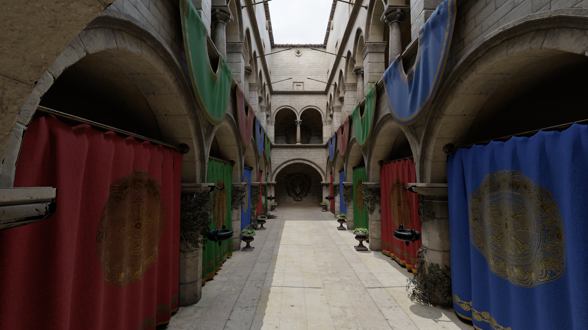
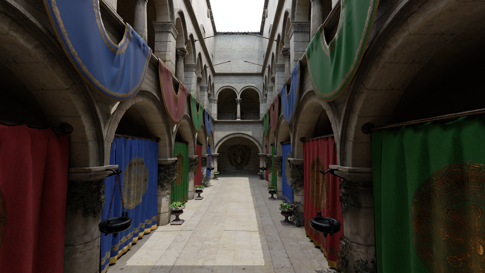
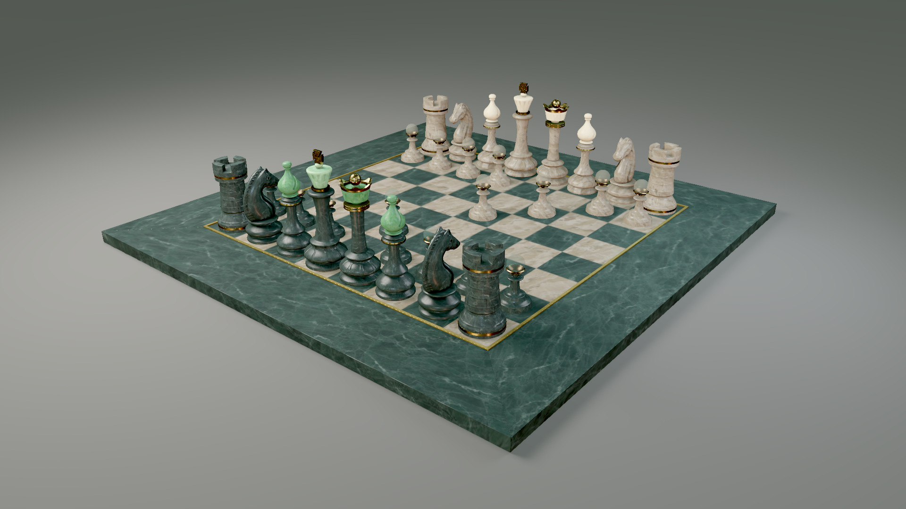
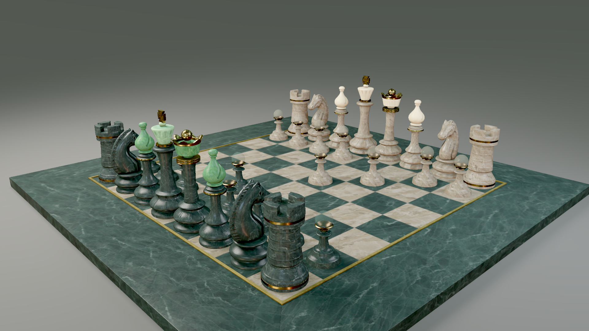
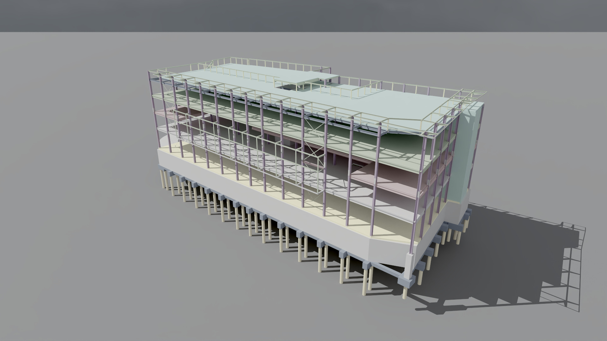
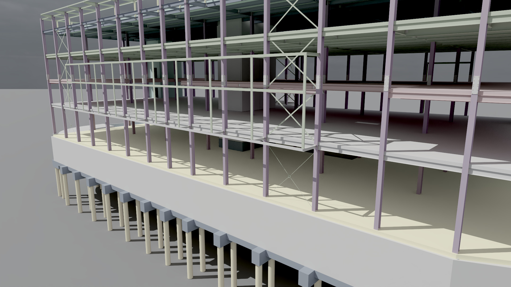

# VulkanSceneRenderer

A C++23 scene renderer and editor built on Vulkan 1.4, with forward and deferred
PBR rendering, progressive path tracing, and native glTF/GLB and IFC/IFCX loading.
Inspect complex scenes, edit materials and transforms, play animation, and save
portable glTF or GLB assets.

## Gallery

Six native 1920 × 1080 renders from VulkanSceneRenderer. Sponza and the BIM
views use path tracing with 512 samples and OptiX display denoising; A Beautiful
Game uses forward PBR with TAA, two studio area lights and its original 2K textures. See the
[model credits and capture notes](docs/images/readme/README.md) for sources,
licenses, scene preparation and reproducible settings.



**Sponza — daylight courtyard, 262,267 triangles**

| Sponza — opposite courtyard | A Beautiful Game — 1.5 million triangles |
| --- | --- |
|  |  |

| A Beautiful Game — material detail | Tekla House — native STEP IFC, 10,042 represented products |
| --- | --- |
|  |  |



**Tekla House — structural detail from the full native IFC model**

## Rendering and scene tools

- **Lighting:** HDR environments, directional and local lights, LTC area lights,
  shadow maps, optional ray-query shadows and dynamic diffuse GI.
- **Rendering:** forward and deferred raster, transparency, GPU culling, MSAA,
  TAA, and optional FSR or DLSS Super Resolution. Progressive reference path
  tracing provides sample diagnostics, scene-linear EXR output, and optional
  display denoising with OptiX or DLSS Ray Reconstruction.
- **Editing:** hierarchy and transform tools, material and texture editing,
  animation playback, authored cameras, undo/redo, glTF merging and portable
  glTF/GLB saving.
- **BIM:** native STEP IFC, IFCX and dotBIM loading, element/property inspection,
  spatial browsing, clipping, measurement, schedules and coordination tools.
- **Inspection:** material, normal, depth and lighting views; renderer telemetry;
  shader reload; display grading; viewport PNG and raw scene-linear EXR export.

The runtime requires a Vulkan 1.4 GPU and driver. Ray queries, reconstruction and
denoising depend on hardware and enabled build options; the application reports
availability and supported fallbacks. Physics, OpenVDB/NanoVDB tools and the
TinyUSDZ importer are optional integrations. USD format coverage depends on that
importer: builds without it retain a limited ASCII USD/USDA and stored text-root
USDZ fallback. See [build options](docs/build-and-test.md) and
[IFC coverage](docs/ifc-import.md) for limits.

Use **Scene Controls → Go to**, **Selection**, or **Material** to find a tool.
The [current editor controls guide](docs/current-editor-controls.md) describes
the available workflows. Rendering uses dynamic rendering and synchronization2,
Vulkan-Hpp RAII, VMA allocations, and Slang shaders compiled to SPIR-V 1.6.
See [the architecture](docs/architecture.md#vulkan-14-rendering) for the frame
flow and ownership model.

## Build and run

Use a Visual Studio Developer Command Prompt with CMake, Ninja, the Vulkan 1.4
SDK and `VCPKG_ROOT` set to your vcpkg checkout:

```powershell
cmake --preset windows-release
cmake --build out/build/windows-release --target VulkanSceneRenderer --config Release
.\out\build\windows-release\VulkanSceneRenderer.exe --model "C:\Models\scene.glb"
```

Keep the complete supplied asset folders, including external buffers and
textures beside `.gltf` inputs. Load an IFC or IFCX model directly:

```powershell
.\out\build\windows-release\VulkanSceneRenderer.exe --model "C:\Models\building.ifc"
```

Try raster TAA with `--taa --msaa 1`, or select **Rendering Engine → Path tracing**
on supported hardware. Lighting controls expose environment, directional and
area-light settings. `Bounce Intensity` is an artistic fill approximation; use
zero when inspecting direct-light occlusion.

The decoded glTF texture budget defaults to 1024 MiB. For larger assets, set
`--texture-memory-mb 2048` as needed for your hardware. This bounds decoded image
preparation; geometry, mipmaps, render targets and other GPU allocations also
need memory. Per-image decoder limits still apply.

```powershell
ctest --test-dir out/build/windows-release --output-on-failure
```

[Build and Test](docs/build-and-test.md) covers exact dependency selection,
optional backends, Linux presets, validation and Windows packaging. Keep local
toolchain paths in an untracked `CMakeUserPresets.json`.

## Published Windows preview

The gallery and features above describe the current source branch. The
[v0.2.0 TAA preview](https://github.com/semihguresci/VulkanSceneRenderer/releases/tag/v0.2.0-taa-preview)
is an **older published prerelease** for testing and feedback; it does not
contain all current branch features. New local validation builds are not a
published release.

Download `VulkanSceneRenderer-0.2.0-taa-preview-windows-x64.zip` under **Assets**.
Extract the entire archive and keep its DLLs and asset folders beside the
executable. It includes precompiled shaders, local sample scenes and the default
HDR environment; Visual Studio, the Vulkan SDK, Slang and Python are not needed
to run that package.

Requirements are Windows 10/11 x64, a Vulkan 1.4 GPU and current driver, and the
[Microsoft Visual C++ v14 Redistributable (x64)](https://aka.ms/vc14/vc_redist.x64.exe).
The renderer checks required Vulkan features at startup. The executable is
unsigned; verify the archive against the release's `SHA256SUMS.txt` using
`Get-FileHash`.

```powershell
.\VulkanSceneRenderer.exe --taa --msaa 1 --display-mode lit
.\VulkanSceneRenderer.exe --model "C:\Models\scene.glb"
```

See the preview's [TAA results and limits](docs/taa-validation.md). Report issues
with the build/release identity, GPU, driver, launch command and console output.

## Documentation

| Topic | Guides |
| --- | --- |
| Start here | [Editor controls](docs/current-editor-controls.md), [Build and test](docs/build-and-test.md), [Architecture](docs/architecture.md), [Project overview](docs/project-overview.md) |
| Rendering | [Reference path tracing](docs/reference-path-tracing.md), [Ray-query shadows](docs/ray-query-rendering.md), [Diffuse GI](docs/ddgi-probe-foundation.md), [LTC area lights](docs/ltc-area-lighting.md), [MSAA](docs/msaa.md), [TAA](docs/temporal-rendering.md) |
| Reconstruction and images | [FSR](docs/fsr-upscaling.md), [DLSS](docs/dlss-upscaling.md), [Display grading and image export](docs/display-and-image-export.md), [Telemetry](docs/renderer-telemetry.md), [GFXReconstruct](docs/gfxreconstruct.md) |
| glTF scenes | [Capabilities](docs/gltf-capabilities.md), [Scene export](docs/gltf-scene-export.md), [Edit history](docs/editor-history.md), [Animation](docs/gltf-animation.md), [Camera authoring](docs/gltf-camera-authoring.md), [Skin/morph deformation](docs/gltf-deformation.md) |
| Materials and assets | [Extended materials](docs/gltf-extended-materials.md), [Texture data](docs/texture-image-data.md), [Instancing](docs/gltf-instancing.md), [Material variants](docs/gltf-material-variants.md), [Interactivity](docs/gltf-interactivity.md) |
| BIM and optional tools | [IFC import](docs/ifc-import.md), [BIM performance](docs/bim-performance.md), [Physics](docs/physics-integration.md), [OpenVDB](docs/openvdb.md), [OpenVDB feature status](docs/openvdb-feature-status.md) |
| Development | [Development guide](docs/development-guide.md), [Coordinate conventions](docs/coordinate-conventions.md), [Model-loading validation](docs/model-loading-validation.md), [Third-party notices](docs/third-party-notices.md) |

The CMake project is `VulkanSceneRenderer`; public headers and source namespaces
retain `include/Container` and `container::`.
