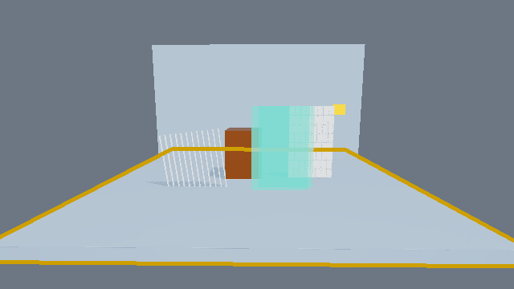
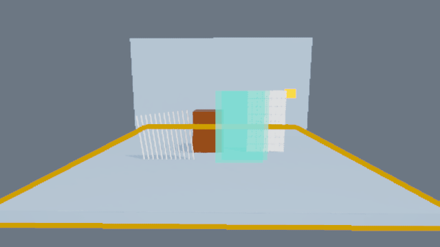
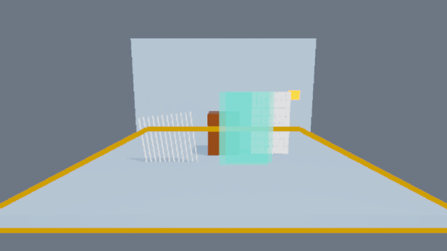
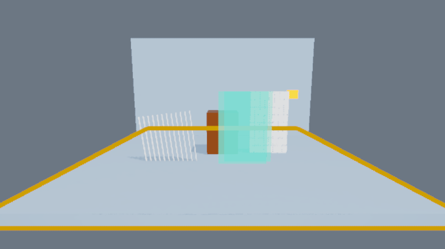
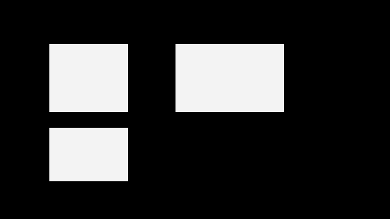
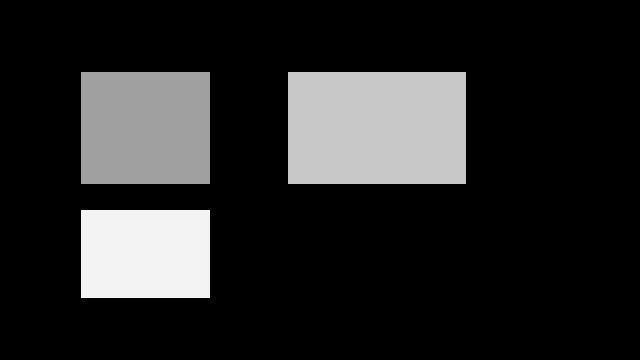
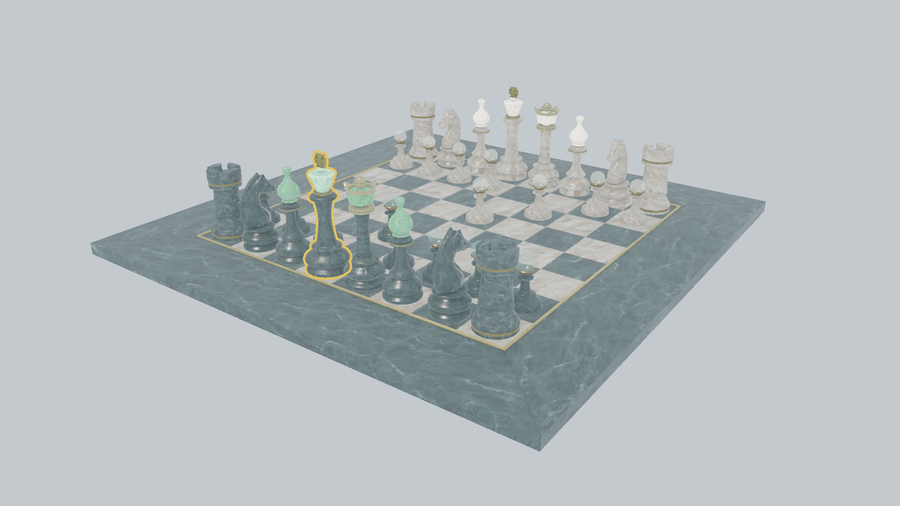
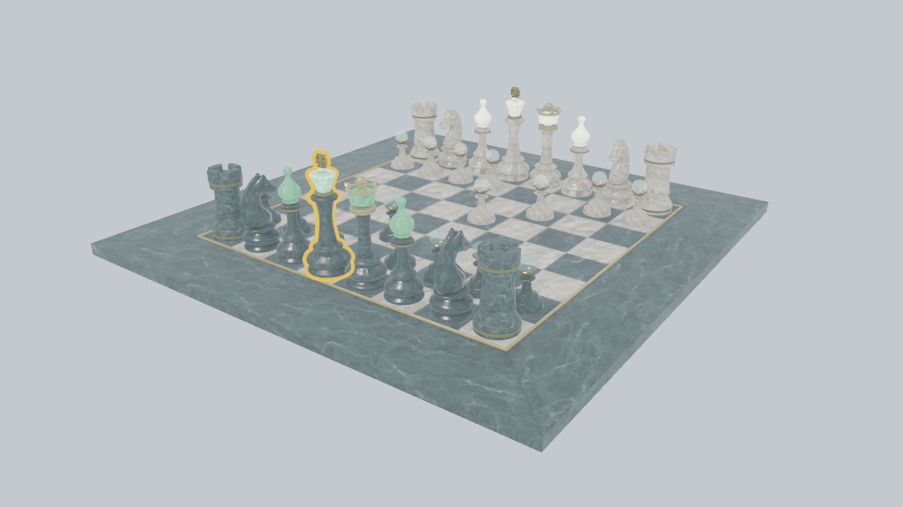

# Vulkan FSR upscaling with AMD FSR SDK 2.4.0

The optional backend uses the signed Windows x64 Vulkan binaries from AMD FSR
SDK 2.4.0 at commit `7539ae8b6568ad29ed78a753404351daf3b5cca7`. The SDK selects a
compatible provider and the engine reports its version after context creation.
The RTX 2080 SUPER audit exercised the bundled analytical FSR 3.1.6 provider.
AMD also lists ML providers for supported AMD hardware and drivers. The table
below records the versions of the installed DLLs separately from the provider.
[Pinned AMD release](https://github.com/GPUOpen-LibrariesAndSDKs/FidelityFX-SDK/releases/tag/v2.4.0)
and [AMD hardware/provider guidance](https://gpuopen.com/amd-fsr-sdk/).

| Signed Windows x64 Vulkan runtime | PE file version |
| --- | --- |
| `amd_fidelityfx_loader_vk.dll` | 1.0.2.4555 |
| `amd_fidelityfx_upscaler_vk.dll` | 4.1.2.4555 |

Configure an existing build with the SDK root. The build checks both signed
Vulkan DLLs, the four public headers and license/notices against the pin. The
application and standalone GPU test stage `amd_fidelityfx_loader_vk.dll` and
`amd_fidelityfx_upscaler_vk.dll` together beside the executable. The loader
contains no effect code. The wrapper owns both module leases, rejects a
same-name module from another directory, and destroys the context before
unloading either module. Missing modules leave the scene at native resolution.
Building without the SDK requires neither AMD DLL nor AMD sample tools.

Both shipped Vulkan DLLs appear among the MIT exceptions in the pinned SDK
license. The Windows package includes `AMD-FSR-SDK-2.4.0-LICENSE.txt` and
`AMD-FSR-SDK-2.4.0-THIRD-PARTY-NOTICES.md` under `THIRD_PARTY_LICENSES/`. The
packager uses CMake's actual FSR availability and checks both DLL hashes.
[Pinned SDK license](https://github.com/GPUOpen-LibrariesAndSDKs/FidelityFX-SDK/blob/v2.4.0/Kits/FidelityFX/docs/license.md).

```powershell
cmake -S . -B build/fsr -DENABLE_FSR_UPSCALING=ON -DCONTAINER_FSR_SDK_ROOT=F:/Libraries/FidelityFX-SDK-v2.4.0
cmake --build build/fsr --target fsr_upscaler_gpu_tests
$env:CONTAINER_RUN_GPU_FSR_UPSCALER = '1'
ctest --test-dir build/fsr -R '^fsr_upscaler_gpu_tests$' --output-on-failure
```

## SDK 2.4.0 compatibility matrix

| `--fsr` mode | Display-to-render ratio per axis | Render extent at 640 × 360 output | Temporal resolve |
| --- | --- | --- | --- |
| `native` | 1.0× | 640 × 360 | TAA when enabled |
| `quality` | 1.5× | 426 × 240 | FSR |
| `balanced` | 1.7× | 376 × 211 | FSR |
| `performance` | 2.0× | 320 × 180 | FSR |

The mode table describes a compatible device and viewport. The render extent
rounds each axis down. If either render dimension falls below two pixels,
the FSR context is rejected and rendering stays at native resolution. ImGui and
captures use the display extent. FSR owns jitter and temporal resolve while
active, including when TAA is selected. Native resolution can use TAA after
FSR is disabled or falls back, subject to the normal TAA requirements.

| Capability or request | Result | Audit coverage |
| --- | --- | --- |
| Windows x64 build with the pinned SDK, both DLLs and a compatible Vulkan device | Uses the SDK-selected provider. The engine applies its format adapter to analytical 3.1.6. | Analytical 3.1.6 on RTX 2080 SUPER. AMD ML and other driver providers are unverified. |
| `ENABLE_FSR_UPSCALING=OFF` or enabled with an empty SDK path | Builds without Vulkan FSR. An upscale request runs at native resolution. | Separate SDK-off build and native image comparison. |
| A supplied SDK root has a missing or mismatched pinned file | CMake rejects that configuration. | Pin checks in `cmake/FsrUpscalerDependencies.cmake`. |
| SDK-enabled build with a missing adjacent loader or upscaler | The runtime stays at native resolution and reports the unavailable DLL pair. | Staged runtime capture and standalone missing-module test. |
| Required Vulkan features or image formats absent, or the provider context cannot initialize | The runtime stays at native resolution and reports why FSR could not activate. | The Khronos Profiles layer masked `VK_KHR_compute_shader_derivatives` on the same tested GPU. Quality, Balanced and Performance matched Native pixel for pixel in deferred and forward raster. Standalone tests cover the provider and image adapter. |
| Perspective deferred or forward raster, MSAA 1×, at most four frames in flight | Eligible in Lit, `taa-velocity` and `taa-reactive` display modes. | Preset transitions in both raster paths, velocity and reactive diagnostics, and UI capture. |
| MSAA above 1×, orthographic or reference rendering, another display mode, or more than four frames in flight | Retains the requested mode and renders at native resolution. | Live MSAA and orthographic fallback and perspective recovery, native path tracing, and source inspection of the display-mode and frame-count gates. |
| Linux, 32-bit Windows, Windows ARM64 or ARM64EC | Vulkan FSR SDK backend stays disabled. | Compiler target probe. Configuration was verified for x64, Win32, ARM64 and ARM64EC with the pinned SDK supplied. |

## Frame inputs and submission

The wrapper takes one-layer, one-mip, single-sample Vulkan images. It imports
render-resolution linear HDR color (`RGBA16F`), jittered reverse-Z depth
(`R32F`), unjittered motion (`RG16F` or `RG32F`) and optional separate masks
(`R8_UNORM`). The caller transitions those images to
`SHADER_READ_ONLY_OPTIMAL` and the presentation-resolution HDR storage
output in `FsrUpscaler::outputFormat()` to `GENERAL`: RGBA32F for the analytical
3.1.6 provider and RGBA16F for the automatic ML/default profile. The caller owns
producer and consumer barriers and keeps
all dispatches ordered on one graphics queue. The AMD backend owns its internal
history, views, and descriptors. The engine requires a graphics queue with
compute support, storage image read/write without format, extended storage
image formats, subgroup size control and full compute subgroups. If the device
advertises `shaderFloat16`, it must also support `storageBuffer16BitAccess`.
The SDK queries physical-device features and needs the corresponding features
enabled on the logical device. [Pinned Vulkan backend](https://github.com/GPUOpen-LibrariesAndSDKs/FidelityFX-SDK/tree/v2.4.0/Kits/FidelityFX/backend/vk)

SDK 2.4.0 analytical shaders also require the device extension
`VK_KHR_compute_shader_derivatives` and `computeDerivativeGroupLinear`.
The engine queries support and enables them before activating FSR; Vulkan 1.4
alone does not supply this extension.

The SDK 1.1.4 integration's exact luma-history SPIR-V rewrite is removed for
SDK 2.4.0. The wrapper passes the signed provider's shaders through unchanged.
The pinned analytical 3.1.6 provider declares Float32 scalar/vector shader images for
fifteen internal images while requesting UNORM8/FP16 host allocations. A private
Vulkan dispatch adapter creates these images and all their views as matching
R32/RG32/RGBA32 float formats. It covers the two luma images,
the shared farthest-depth/luma-instability intermediate, farthest-depth mip1,
SPD pyramid, private dilated velocity, two accumulation images, shading-change
and new-lock masks, two internal color histories, two luma histories, and the
dilated reactive masks. All have uninitialized data and
use default heaps; no packed CPU uploads, readbacks or image copies need
conversion. Their allocations follow Vulkan's actual memory requirements and
their texel storage increases by 2x to 4x. Valid mask values remain in [0,1]
through the SDK's saturation/threshold logic; the wider images remove UNORM8
rounding and FP16 rounding. This preserves continuous value meanings and is not
an exact output-equivalence claim; temporal threshold effects are covered by
the fixture acceptance below. The initialized sampled-only default R8 mask and SNORM LUT remain
unchanged. The adapter queries exact format usage,
dimensions, mip count and linear filtering support. Unsupported devices retain
native rendering. [Pinned resource descriptions and creation](https://github.com/GPUOpen-LibrariesAndSDKs/FidelityFX-SDK/blob/v2.4.0/Kits/FidelityFX/upscalers/fsr3/internal/ffx_fsr3upscaler.cpp#L524)

A passthrough probe first lets the SDK choose its automatic provider. Only the
exact pinned analytical 3.1.6 result is recreated with an enumerated explicit
provider ID and the adapter, then verified again. ML and driver providers keep
their unmodified contexts. Caller images are absent from the adapter's fixed
ownership table and keep their formats; the private velocity image's reimported
views are corrected by owned image handle. Context scopes and image destruction
remove ownership entries before module release.

The analytical provider's caller-owned HDR output is allocated directly as
RGBA32F before descriptor creation, without a conversion copy. Both raster
techniques' post-processing, exposure and bloom read it through sampled
Texture2D inputs; their own typed storage outputs retain their formats. DLSS
and the ML/default FSR profile continue to allocate RGBA16F output. Temporal
resource caching and logical payload accounting use the selected output format.

Unexpected internal image/view contracts latch a failure. An unexpected view
of an already promoted image receives a legal compatible placeholder so the
SDK can finish creating a destructible context. That candidate is then rejected
before submission; a mismatch while recording discards the commands. Actual
Vulkan failure codes are preserved. The SDK's public source has a preexisting
partial-create cleanup limitation: driver allocation failure can return before
publishing a context, without releasing every partial CPU/GPU allocation. The
adapter does not claim to repair that SDK error path. Failed destruction is
reported and keeps the runtime modules resident rather than pretending their
objects were released. Pre-context SDK memory estimates still describe narrow
formats; only actual context memory accounting includes the wider allocations.
New SDK numerical and native acceptance must pass strict Vulkan validation;
historical shader fingerprints are not applied to this runtime.

The projected jitter is in render pixels with +X right and +Y down. Use
`nextJitterPixels()` when producing both the jittered projection and the
dispatch. The existing velocity shader already measures `previousUv - currentUv`
in unjittered upper-left UVs. The dispatch uses positive render width and
height scales, with no additional Y sign change. Dispatch receives milliseconds,
physical camera near and far distances, perspective vertical FOV in radians,
and linear HDR with pre-exposure 1. The SDK runs internal exposure estimation
and returns linear HDR to the viewer's later exposure and tone mapping.
[AMD integration manual](https://gpuopen.com/manuals/fsr_sdk/techniques/super-resolution-upscaler/)

The first recorded frame resets history. Explicit camera or scene cuts also
set `reset`. `commit()` advances jitter only after a successful submit.
Discarding an already recorded frame invalidates the AMD context because the
SDK rotated its resources while recording. Recreate the context once work is
retired, and destroy it before destroying imported images. An ordinary resize,
quality change, or finite/infinite projection change uses the same retirement
boundary. The synthetic fixture checks repeated HDR dispatches, invalid input,
missing runtime fallback, and reconstruction of an abandoned dispatch.

## Resolution and composition

Depth, G-buffer, raster HDR, OIT, temporal inputs, culling tiles and scene-space
effects use the render extent. Swapchain framebuffers, display post-process,
ImGui and screenshots use the presentation extent. The camera projection uses
the presentation aspect, while its jitter and scene sampling use render pixels.

Both raster techniques share the `TemporalManager` velocity and HDR compose
boundary. FSR reuses that velocity and OIT composition, then converts the depth
and motion and writes separate reactive and composition masks. OIT feeds both
FSR masks with the resolved transparent opacity, `1 − revealage`, combined
with existing surface and volume reactivity. The reactive mask is capped at
0.9. New surfaces, unsupported motion, emissive shading and OIT overflow
retain conservative reactivity. Native TAA and DLSS retain their existing
binary OIT policy. Exposure, bloom and post-processing consume the upscaled
linear HDR. Engine allocation telemetry covers its own velocity, conversion
and presentation images. The AMD runtime owns and manages its internal history.
[AMD FSR 3.1.6 mask guidance](https://gpuopen.com/manuals/fsr_sdk/techniques/super-resolution-upscaler/#reactive-mask)

## Executable verification

Build `fsr_vulkan_image_adapter_tests` for CPU coverage of the pinned format
adapter. Run the GPU target with the opt-in environment variable shown above
to exercise module loading, context creation, HDR dispatch and dispatch
abandonment on Vulkan.

With Python 3.11 or newer, NumPy and Pillow, run the end-to-end capture fixture
from the repository root. Point `$manifest` to the
`VkLayer_khronos_validation.json` used by the installed Vulkan validation layer.
Give each run a new output directory.

```powershell
python -B tests/validation/fsr_upscaling_runtime_regression.py `
  --renderer build/fsr/VulkanSceneRenderer.exe --output build/fsr-verification/active `
  --suite full --expect-provider 3.1.6 --validation-manifest $manifest
python -B tests/validation/fsr_upscaling_runtime_regression.py `
  --renderer build/fsr-off/VulkanSceneRenderer.exe --output build/fsr-verification/sdk-off `
  --expect-fallback sdk-disabled --validation-manifest $manifest
python -B tests/validation/fsr_upscaling_runtime_regression.py `
  --renderer build/fsr-missing-dll/VulkanSceneRenderer.exe --output build/fsr-verification/missing-dll `
  --expect-fallback missing-runtime --validation-manifest $manifest
```

Build the second executable with `-DENABLE_FSR_UPSCALING=OFF`. For the third
run, stage the SDK-enabled executable with its runtime files in a separate
directory and omit `amd_fidelityfx_upscaler_vk.dll`. Keep the loader beside the
executable. The fallback tests compare PNG pixels against ordinary native
rendering and check the reported cause. The active suite checks the provider,
render and display extents, forward transparency, motion and camera cuts,
mode switches, reload, resize, MSAA recovery, velocity and reactive displays,
and UI capture. It also switches between standalone TAA and FSR, checking
resolve ownership, jitter and history. Each run records DLL and executable
identity, validation settings and the loaded validation library in
`results.json` alongside the per-frame telemetry and screenshots.

### Audit results

The SDK 2.4.0 build passed 18 CPU adapter tests and four wrapper tests, including
three Vulkan device tests. The RTX 2080 SUPER with NVIDIA driver 610.88 used
analytical 3.1.6 and passed 44 captures across nine processes. Both fallback
profiles passed 17 captures each. In each profile, all six frames requested
with Quality were pixel-identical to their native control frames. Vulkan
validation layer 1.4.363.1 reported no errors with synchronization validation
enabled. The maximum mean absolute RGB difference from native across the six
active Quality frames was 1.935 on the 0–255 scale.

| Fixture and mode | Median instrumented GPU pass total | Median resolve GPU time | Engine temporal images |
| --- | ---: | ---: | ---: |
| 640 × 360 deferred Native | 18.449 ms | — | 0 bytes |
| 640 × 360 deferred Quality | 6.338 ms | 0.188 ms | 27,377,664 bytes |
| 1280 × 720 forward Native | 102.267 ms | — | 0 bytes |
| 1280 × 720 forward Performance | 20.632 ms | 0.754 ms | 81,838,080 bytes |

These are fixture measurements with synchronization validation enabled and TAA
disabled for the four rows. The memory counts cover engine temporal images.
AMD-owned context allocations require separate measurement.

Frame 8 from `models/validation/taa_scene.gltf` at 640 × 360 uses the same
camera, lighting and scene state in each capture.

| Native at 640 × 360 | FSR Quality at 426 × 240, reconstructed to 640 × 360 |
| --- | --- |
|  |  |

## Resize and swapchain regression

The resize suite exercises forward and deferred raster at 640 × 360,
731 × 409 and 576 × 416. It captures the first usable submission and a
settled frame after changes to the display extent, FSR mode, MSAA and WSI
state. It checks the display and render extents, presentation-aspect camera,
temporal history, graphics pass activity and Vulkan validation. At both
resized extents, each FSR mode must match the same-size native image more
closely than a vertically flipped image. The suite also checks native
rendering through an orthographic viewport resize and restores FSR on return
to perspective.

```powershell
python -B tests/validation/fsr_upscaling_runtime_regression.py `
  --renderer build/fsr/VulkanSceneRenderer.exe --output build/fsr-verification/resize `
  --suite resize --validation-manifest $manifest
```

Add `--resize-format bgra8-unorm` where that format is supported and the
initial swapchain uses a different format. A format-only change rebuilds the
presentation pipelines. When the swapchain image count and extent stay the
same, it keeps the existing FSR history. An optional `--resize-reference`
run checks that a hardware ray-traced viewport renders at native extent and
that FSR returns on switching back to raster.

The window captures compare the opaque Scene Controls title across Native,
Quality and Performance at the same display extent. The paired viewport-only
PNGs check that the title comes from presentation composition. Separately,
two glTF cases enable extended PBR for the first time with FSR active, through
a material edit and a scene merge. Both then resize and switch modes while
the auxiliary pass remains active. Before the fix, starting either transaction
issued `VUID-VkRenderingInfo-pNext-06079` and `06080` because the auxiliary
render area used the display extent with a smaller scene depth attachment.
Both transactions now create the auxiliary targets at the scene render extent.

On the RTX 2080 SUPER, analytical FSR 3.1.6 passed 91 captures with
synchronization validation enabled. The format-only BGRA8 sRGB to UNORM
transition preserved the FSR epoch in both raster paths. At the resized
extents, aligned images differed from native by at most 2.958 mean absolute
RGB levels on the 0–255 scale. Vertically flipped controls differed by at
least 29.455. All 198 opaque title pixels matched their native controls in
each of the three UI comparisons.

| Display and mode | Render extent | Median deferred graphics time | Median forward graphics time | Engine temporal images |
| --- | --- | ---: | ---: | ---: |
| 640 × 360 Native | 640 × 360 | 17.173 ms | 20.197 ms | 0 bytes |
| 640 × 360 Quality | 426 × 240 | 6.669 ms | 7.174 ms | 27,377,664 bytes |
| 731 × 409 Balanced | 430 × 240 | 6.978 ms | 7.543 ms | 33,619,968 bytes |
| 576 × 416 Performance | 288 × 208 | 5.020 ms | 4.963 ms | 24,625,152 bytes |

These medians use matched, retired GPU timestamps from the settled part of
each phase. The output `results.json` records both sample points, validation
layer identity, resolve timing and VMA allocation counts. Engine temporal
image bytes exclude AMD-owned context memory.

The before and after viewport PNGs use the same fixed camera in FSR Quality.

| Before resize, 640 × 360 display | After resize, 731 × 409 display |
| --- | --- |
|  |  |

## Temporal input and ghosting regression

```powershell
python -B tests/validation/fsr_upscaling_runtime_regression.py `
  --renderer build/fsr/VulkanSceneRenderer.exe --output build/fsr-verification/temporal `
  --suite temporal --validation-manifest $manifest
```

The suite projects known scene and camera translations and checks the signed
render-pixel displacement in the renderer velocity view. It checks finite
reverse-Z readback against two authored depth planes. It also compares the
applied projection jitter against the analytical provider's jitter sequence
and the committed SDK dispatch receipt. `fsr.frameTimeMs`, `jitterPixels`,
`motionVectorScale` and `preExposure` report the last dispatch submitted to the
active FSR context. A fixed 60 Hz sequence checks that two skipped ticks carry
50 ms into the following submission while jitter advances once. The viewer's
manual exposure step is compared with a constant-exposure control to verify
that display exposure stays outside the scene-linear FSR history.

The opacity fixture checks single and overlapping transparent layers against
the resolved opacity, alongside opaque, cutout and emissive controls. The
ghosting fixture moves alpha-tested foliage, translucent glass and an HDR emissive object in both
directions. Native captures define the vacated and newly occupied sample
regions. A live FSR history and a same-frame FSR reset use identical poses,
jitter and exposure. The report tracks retained old color and recovery of newly
visible surfaces through motion and for 16 frames after arrival.

The RTX 2080 SUPER passed 130 captures with analytical FSR 3.1.6 and Vulkan
synchronization validation enabled. Both raster paths measured object motion
of (−3.120, +2.312) render pixels and camera motion of (+3.102, −2.060), each
within 0.03 pixels per axis of the projection oracle. The nearest and farthest
depth probes measured 0.0124012 and 0.0082342. Submitted frame times around
two skipped ticks were 16.67 ms, 50.00 ms and 16.67 ms.
After stepping display exposure from 0.5 to 0.95, the PNGs matched the 0.95
control pixel for pixel with the history epoch preserved.

In both raster paths the old reactive view gave both transparent samples
243/255. With the fix it gives 160/255 for one 0.35-opacity layer and 200/255
for two overlapping layers. In the ghosting fixture, neither foreground
material retained measurable old-color signal in the vacated interior at any
sample from four through 16 frames after arrival.

The moving emitter vacated 790 measured pixels on each arrival in both raster
paths. All vacated emissive pixels in the live history matched the same-frame
reset at every sample. Newly occupied pixels matched the native control from
arrival through the 16-frame hold.

| Before opacity weighting | After opacity weighting |
| --- | --- |
|  |  |

| Ghosting fixture at 640 × 384 | Median instrumented GPU pass total | Median FSR resolve | Engine temporal images |
| --- | ---: | ---: | ---: |
| Deferred Native | 2.793 ms | — | 0 bytes |
| Deferred Quality | 1.182 ms | 0.216 ms | 27,377,664 bytes |
| Forward Native | 2.954 ms | — | 0 bytes |
| Forward Quality | 1.142 ms | 0.215 ms | 27,377,664 bytes |

The fixture timings are validation-enabled. Memory covers the engine's
temporal images. Detailed per-frame values are in the suite's `results.json`.

## Representative-scene benchmark

The benchmark runs Native, native TAA, FSR Quality, Balanced and Performance
on three original assets. Set `$sponza`, `$chess` and `$tekla` to the paths of
`Sponza.gltf`, `ABeautifulGame.gltf` and `TeklaHouse.ifcx`, respectively. Keep
each glTF's external buffers and images beside the model. The runner hashes
these inputs and records exact commands, camera tracks, telemetries and PNGs.
[Sponza](https://github.com/KhronosGroup/glTF-Sample-Assets/tree/8f492390ddc7a2ae221a1369ef560589cf8c70fb/Models/Sponza) ·
[A Beautiful Game](https://github.com/KhronosGroup/glTF-Sample-Assets/tree/8f492390ddc7a2ae221a1369ef560589cf8c70fb/Models/ABeautifulGame) ·
[Tekla House](https://github.com/buildingSMART/IFC5-development/tree/1a63082ada967c683cfacee2005f8f749c8e1b79/examples/Tekla%20House)

```powershell
python -B tests/validation/fsr_quality_performance_benchmark.py `
  --renderer build/fsr/VulkanSceneRenderer.exe --output build/fsr-verification/benchmark `
  --sponza $sponza --gltf $chess --bim $tekla

python -B tests/validation/fsr_quality_performance_benchmark.py `
  --renderer build/fsr/VulkanSceneRenderer.exe --output build/fsr-verification/benchmark-validation `
  --sponza $sponza --gltf $chess --bim $tekla --extent 1920x1080 --warmup 12 --samples 8 `
  --validation-manifest $manifest
```

The primary run uses 1920 × 1080 and 2560 × 1440 output, deferred raster,
1× MSAA and the same serialized graphics policy in every mode. It uses a
fixed timestep, manual exposure, a warm-up at the initial view and a small
camera move. Raw PNGs bracket 32 uncaptured submissions. The profiler measures
GPU graphics command buffer duration with retired timestamps matched by
submission ID. These are GPU frame costs at the chosen settings. The separate
validation run enables Vulkan synchronization validation.

The report compares each reconstructed view against its same-frame native
control using 8-bit RGB mean absolute error and PSNR. It records device-local
engine allocations from VMA and GPU memory reported by the active SDK context
as separate quantities. The SDK's aliasable bytes are a subset of its total.
Engine temporal images are already included in VMA. Optional NVML readings
capture device-wide usage, which also includes the desktop and other GPU
clients.

The RTX 2080 SUPER with driver 610.88 completed 30 timed cases on FSR SDK
2.4.0 with the analytical 3.1.6 provider. All 15 mode and scene combinations
at 1080p also passed Vulkan synchronization validation with layer 1.4.363.1.
The loaded scenes contained 103 Sponza render objects, 49 A Beautiful Game
objects and 8,790 Tekla IFCX objects. `results.json` keeps the 60 matched
PNGs' hashes and telemetry paths, the renderer and source asset identities,
and the underlying timing and image measures.

GPU graphics duration in milliseconds is shown as median / p95 over 32
retired submissions per case. At 1440p, Quality reduced GPU time from 7.98
to 6.08 ms in Sponza and from 7.65 to 6.44 ms in A Beautiful Game. On Tekla
it took 12.87 ms compared with 10.87 ms for Native and 13.28 ms for TAA.
Tekla's 1440p Quality capture recorded about 1.50 ms in velocity and 1.63 ms
in temporal resolve.

| Scene | Display | Native | TAA | Quality | Balanced | Performance |
| --- | --- | ---: | ---: | ---: | ---: | ---: |
| Sponza | 1920 × 1080 | 4.74 / 5.19 | 5.52 / 6.03 | 3.90 / 4.30 | 3.42 / 3.84 | 2.90 / 3.68 |
| Sponza | 2560 × 1440 | 7.98 / 8.62 | 9.62 / 10.09 | 6.08 / 6.83 | 5.20 / 5.97 | 4.33 / 5.08 |
| A Beautiful Game | 1920 × 1080 | 5.15 / 5.56 | 5.76 / 6.44 | 4.71 / 5.16 | 4.37 / 4.79 | 4.04 / 4.08 |
| A Beautiful Game | 2560 × 1440 | 7.65 / 8.27 | 8.92 / 9.79 | 6.44 / 7.04 | 5.76 / 6.31 | 5.14 / 5.74 |
| Tekla IFCX | 1920 × 1080 | 9.81 / 10.11 | 11.87 / 12.25 | 11.55 / 11.90 | 11.32 / 11.67 | 11.09 / 11.28 |
| Tekla IFCX | 2560 × 1440 | 10.87 / 11.17 | 13.28 / 13.83 | 12.87 / 13.18 | 12.44 / 12.81 | 11.95 / 12.25 |

Allocated memory in MiB is shown as device-local engine / FSR SDK at the
terminal capture. The device-wide NVML readings for the timed run ranged
from 4.19 to 6.79 GiB on the 8 GiB adapter.

| Scene | Display | Native | TAA | Quality | Balanced | Performance |
| --- | --- | ---: | ---: | ---: | ---: | ---: |
| Sponza | 1920 × 1080 | 2781 / — | 3100 / — | 2421 / 159 | 2272 / 138 | 2182 / 129 |
| Sponza | 2560 × 1440 | 3628 / — | 4195 / — | 2993 / 283 | 2752 / 250 | 2520 / 218 |
| A Beautiful Game | 1920 × 1080 | 3162 / — | 3481 / — | 2802 / 159 | 2653 / 138 | 2563 / 129 |
| A Beautiful Game | 2560 × 1440 | 4009 / — | 4576 / — | 3374 / 283 | 3133 / 250 | 2901 / 218 |
| Tekla IFCX | 1920 × 1080 | 2480 / — | 2799 / — | 2120 / 159 | 1971 / 138 | 1881 / 129 |
| Tekla IFCX | 2560 × 1440 | 3327 / — | 3894 / — | 2692 / 283 | 2451 / 250 | 2220 / 218 |

Terminal PNG comparison against the matching Native view is shown as
mean absolute error in 8-bit channel levels / PSNR in dB.

| Scene | Display | TAA | Quality | Balanced | Performance |
| --- | --- | ---: | ---: | ---: | ---: |
| Sponza | 1920 × 1080 | 2.18 / 32.9 | 4.00 / 29.4 | 4.64 / 28.4 | 5.55 / 27.2 |
| Sponza | 2560 × 1440 | 1.98 / 33.7 | 3.73 / 29.9 | 4.34 / 28.9 | 5.26 / 27.7 |
| A Beautiful Game | 1920 × 1080 | 0.53 / 40.8 | 0.65 / 38.2 | 0.75 / 37.3 | 0.88 / 36.1 |
| A Beautiful Game | 2560 × 1440 | 0.48 / 41.7 | 0.58 / 39.3 | 0.66 / 38.3 | 0.77 / 37.2 |
| Tekla IFCX | 1920 × 1080 | 0.37 / 39.6 | 1.13 / 37.5 | 1.43 / 36.4 | 1.83 / 35.0 |
| Tekla IFCX | 2560 × 1440 | 0.29 / 40.8 | 0.63 / 39.5 | 0.87 / 38.7 | 1.24 / 37.4 |

The paired viewport PNGs show the terminal camera pose in *A Beautiful Game*.
The MaterialX Project at ASWF created the model and Ed Mackey converted it
to glTF. [Source and attribution](https://github.com/KhronosGroup/glTF-Sample-Assets/tree/8f492390ddc7a2ae221a1369ef560589cf8c70fb/Models/ABeautifulGame) ·
[CC BY 4.0](https://creativecommons.org/licenses/by/4.0/)

| Native at 1920 × 1080 | FSR Quality at 1280 × 720, reconstructed to 1920 × 1080 |
| --- | --- |
|  |  |

### Extracted Windows packages

Build a Release ZIP with the pinned FSR SDK and a separate ZIP with
`ENABLE_FSR_UPSCALING=OFF`. Use distinct package output directories so each
archive has its own `SHA256SUMS.txt` receipt. Set `$enabledZip` and `$sdkOffZip`
to the archives. [Windows packaging instructions](build-and-test.md#windows-release-package)

```powershell
python -B tests/validation/fsr_windows_package_smoke.py `
  --archive $enabledZip --sdk-off-archive $sdkOffZip --output build/fsr-verification/packages
```

The smoke test verifies the archive and staged runtime hashes, including
the renderer, shaders, runtime DLLs and FSR notices. The app launches from
an unrelated working directory with an OS-only `PATH`, using the installed
driver and MSVC redistributable. It exercises Native and FSR Quality on both
raster paths. A second extraction with the upscaler DLL absent and the SDK-off
ZIP each verify pixel-exact native fallback against their native controls.

### Native recovery during rendering

An FSR scene-grid or temporal resource setup failure switches to native frame
resources before command recording. A rejected jitter query or dispatch
abandons the unsubmitted commands, consumes the swapchain acquire signal and
recreates the swapchain and native frame resources. Interactive rendering
resumes at the current display extent on the next draw. Scripted captures
retry the same tick. Only a successful submission advances the submitted frame
number and SDK jitter. The requested preset and failure message are retained
across resize. Changing the preset or backend allows a fresh FSR context to
start with reset history.

```powershell
python -B tests/validation/fsr_upscaling_runtime_regression.py `
  --renderer build/fsr/VulkanSceneRenderer.exe --output build/fsr-verification/recovery `
  --suite recovery --validation-manifest $manifest
python -B tests/validation/fsr_upscaling_runtime_regression.py `
  --renderer build/fsr/VulkanSceneRenderer.exe --output build/fsr-verification/device-fallback `
  --suite device-fallback --validation-manifest $manifest --profiles-manifest $profilesManifest
```

Point `$profilesManifest` to `VkLayer_khronos_profiles.json`. The device test
masks `VK_KHR_compute_shader_derivatives` on the same physical device and checks
20 captures across the masked and unmasked runs. The recovery suite injects
resource, jitter and dispatch failures in both raster paths. Its first-frame
dispatch case also checks that the retried frame initializes the shadow fallback
image. All 98 captures passed on the RTX 2080 SUPER with Vulkan synchronization
validation. The recovered frames matched the native motion and odd-size resize
controls pixel for pixel. Each reselected preset started with the provider's
first jitter.

## Remaining work

- Qualify AMD ML and other SDK-selected providers on supported devices. Add a
  run on a separate physical device missing the FSR features and repeat the
  extracted package smoke on a Windows installation with only the driver and
  redistributable installed.
