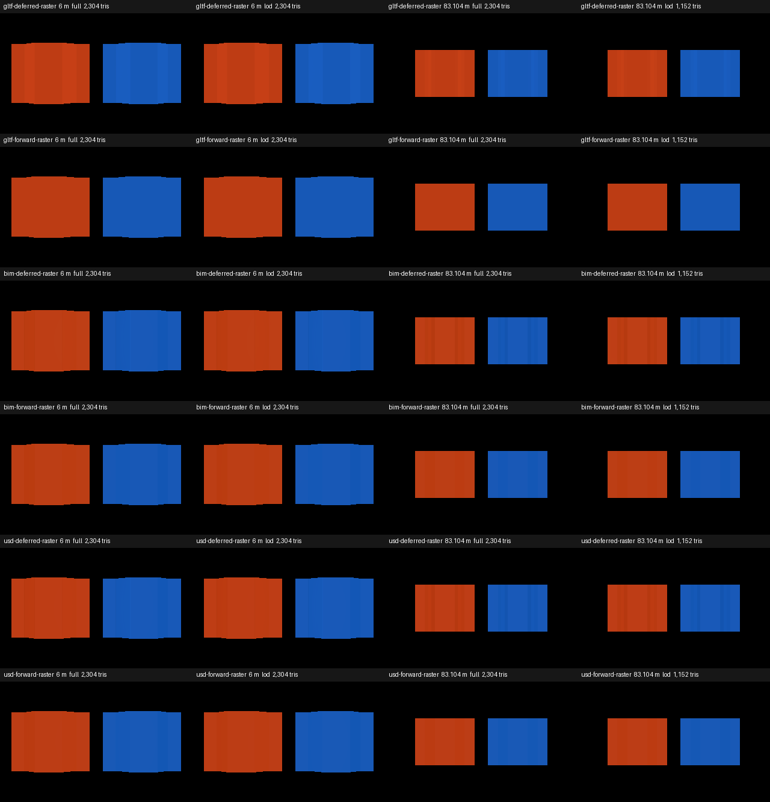

# Geometry level of detail

`--geometry-lod-error PIXELS` enables generated triangle LODs for the interactive
forward and deferred raster viewports. The option is set at launch. The default
is `0`, which skips generation and draws the imported triangles. A positive value
sets the maximum projected error for an active level. Larger values allow
simplified geometry at shorter viewing distances.

```powershell
.\VulkanSceneRenderer.exe --model path\to\model.usda --geometry-lod-error 2
```

## Import and storage

The renderer simplifies each eligible primitive or mesh range independently and
keeps the original vertex buffer and material assignment. The first eligible
primary raster frame starts glTF LOD preparation for a geometry revision.
With streaming enabled, source draws remain active while a worker generates the
levels and the renderer stages the optional index buffer. BIM/USD generation
runs during model preparation and appends the simplified ranges to its geometry
upload. Both paths use the scene asset residency and upload budgets. A budget
that fits only the source geometry can retain the source draws.
[Geometry streaming](geometry-streaming.md)

The simplifier collapses interior edges onto existing vertices in a deterministic
order using accumulated endpoint displacement. Open boundaries, nonmanifold
edges, sharp creases, and discontinuous vertex attributes protect the affected
vertices. The topology and orientation checks reject collapses that would split a
vertex fan, create duplicate faces, or fold a surviving triangle. Face-expanded
BIM/USD imports can share coincident topology when their attributes agree.
The importer can ignore generated tangent differences for ranges whose materials
do not use them. Each level targets one-half or one-quarter of the source
triangles and is published only when it removes at least one-fifth of the
preceding level's triangles. Eligible ranges contain 96 to 131,072 source
triangles. Malformed and unsuitable ranges keep their original detail. Primary
glTF preparation also bounds the snapshot size, total generation work, and the
size of the optional index allocation.

## Per-frame selection

The renderer projects the level's maximum local displacement into viewport
pixels. Perspective projection accounts for the model transform, the near side
of its world-space bounding sphere, and off-axis displacement. Orthographic
projection depends on viewport scale and zoom. Selection uses the unjittered
camera. A bound intersecting the near plane or an invalid projection uses
full detail.

A change to a coarser level requires its error to be at or below 80% of the
configured limit. That level carries forward until the error exceeds the full
limit. An object moving away can therefore use finer geometry than one coming
toward the camera at the same distance. The previous selection belongs to the
draw instance so differently placed instances can choose different levels.

## Full-detail paths

- Raster picking follows the displayed ranges and keeps the original object IDs,
  BIM GUIDs, and material bindings. CPU picking queries the imported geometry.
- A selected BIM product uses full detail for every fragment in that product.
  Section and box clipping, wireframe, and BIM hidden-line output use full
  detail. Floor plans, native points and curves, and volumes use their own
  rendering paths.
- Primary scenes using glTF skinning or morph deformation use the original
  topology. Rigid transforms are included in the projection used for level
  selection.
- Ray-query acceleration structures and reference path tracing use the source
  geometry. Level selection does not require ray-query hardware.
- Physics uses the existing collider inputs. The glTF box collider is fitted to
  the canonical primitive indices and vertices. BIM/USD product colliders use
  the canonical fragment bounds and transforms grouped by product identity.
  Raster LOD changes do not rebuild or substitute these colliders.

## Reproduce the checks

Build `VulkanSceneRenderer` and `geometry_lod_tests`, then run the tests below.
The GPU regression requires a display, the Vulkan validation layer, and Python
Pillow.

```powershell
ctest --test-dir build -C Release -R '^geometry_lod_tests$' --output-on-failure
$env:CONTAINER_RUN_GPU_GEOMETRY_LOD = '1'
ctest --test-dir build -C Release -R '^geometry_lod_gpu_regression$' --output-on-failure
```

The GPU regression generates two colored folded panels in glTF, dotBIM, and
USD, then runs matched full-detail and LOD camera sweeps through both raster
techniques with ray queries disabled. It repeats the enabled sweep and checks
triangle counts, hysteresis, silhouettes, coverage, picked identities, and
material colors at equivalent camera positions. BIM/USD checkpoints prove
GPU draw compaction with a storey filter, full detail for the selected product,
and full detail during section clipping. A separate dotBIM fixture tests
admission under a budget that fits only the source geometry. The run writes
`results.json`, `comparison.png`, per-frame telemetry and PNGs, and Vulkan validation logs
under `build/test_results/geometry-lod`. The report records selected triangles,
additional index bytes, total scene residency, and measured pass timings. The
panels isolate correctness and triangle reduction. Evaluate throughput on a
larger representative model at a fixed camera position with matched rendering
settings and a steady timing sample.

## Native validation results

On a GeForce RTX 2080 SUPER, the six provider and raster combinations produced
1,562 PNG captures with Khronos synchronization validation enabled and no
validation errors. The matched sweeps had identical silhouette masks, zero
interior holes, and the same picked BIM GUIDs, material bindings, and glTF
source identities at every sampled distance. Each repeated sweep reproduced
the first sweep's levels and identities.



Each fixture starts with 2,304 triangles. The comparison shows full detail at
6 m and the first simplified stop at 83.104 m. The distant crops use nearest
neighbor enlargement. The table gives the triangle count and median sum of GPU
pass timestamps at the farthest stop, 234.871 m.

| Format | Far triangles | Additional index bytes | Deferred GPU ms, full → LOD | Forward GPU ms, full → LOD |
| --- | ---: | ---: | ---: | ---: |
| glTF | 576 | 48,528 | 0.465 → 0.462 | 0.391 → 0.387 |
| dotBIM | 736 | 22,656 | 0.401 → 0.397 | 0.272 → 0.269 |
| USD | 736 | 22,656 | 0.399 → 0.395 | 0.271 → 0.267 |

The separate 4,512-triangle dotBIM fixture used 1,079,392 resident bytes with
LOD ranges. With a 1 MiB cap it used 1,038,784 resident bytes, kept the source
draw, and returned the same GPU pick identity.

On the same GPU, a fixed 205 m view of 64 glTF panels at 640 × 400 reduced
131,072 triangles to 32,768 and added 2,752,656 resident bytes. Across 32 matched
deferred raster submissions per mode after 24 warmup frames, median GPU
graphics time went from 1.078 ms to 0.621 ms. The 95th percentile went from
1.439 ms to 1.269 ms. In a separate 16-frame TAA capture with ray queries
disabled, both panels retained their raw GPU pick IDs and selected levels as
the jitter changed.
