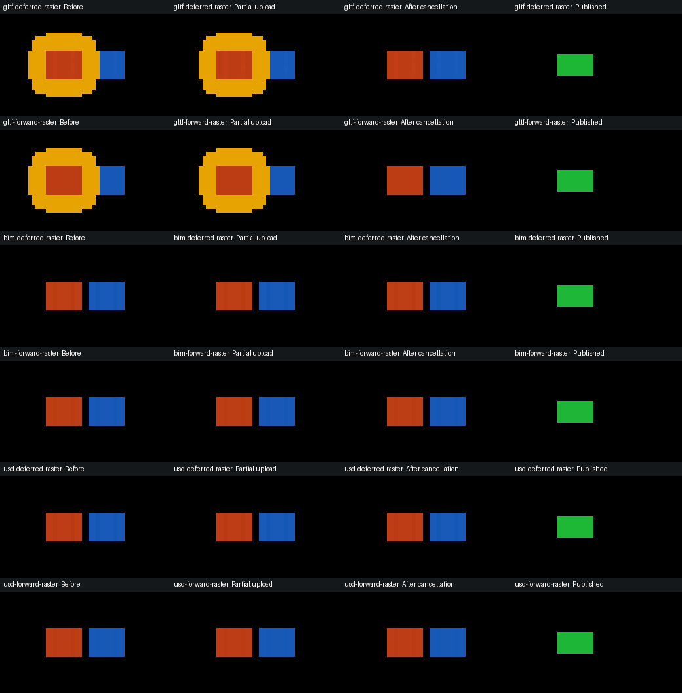

# Geometry streaming

The app streams vertex and index buffers for interactive rigid glTF, dotBIM,
IFC, and USD model replacements. Open the app, then use **Load model** in
Scene Controls to replace the active model. `--geometry-upload-kb` sets the
maximum geometry copy per service tick in KiB. The default is `1024`. Set a
value from `1` to `4096` to use streaming, or `0` to use the synchronous
geometry upload path.

```powershell
.\VulkanSceneRenderer.exe --geometry-upload-kb 256 --asset-upload-mb 2
```

## Preparation and publication

The model preparation worker decodes the source and builds the CPU vertex and
index streams. The render thread allocates separate device buffers for the
candidate and one mapped VMA staging buffer for the batch. Each service tick
polls the previous copy's fence. Once that fence signals, the batch can reuse
the staging memory, command buffer, and fence for the next copy. Copies run on
the graphics queue and record a Vulkan memory barrier for later vertex, index,
or transfer reads. A busy fence defers the copy to a later tick.

The active model continues to render while the candidate's buffers are being
filled. The renderer installs the candidate only after its last copy completes
and then updates the provider's draw data and asset identity. A superseding
request, unload, or shutdown cancels remaining copies. An already submitted
copy retains its buffers until the fence retires. An explicit unload also
clears the active scene.

The configured copy size is limited by `--asset-upload-mb` when that cap is
set. VMA allocation sizes count against the staging and resident asset budgets.
The resident budget must cover the old scene and incoming device buffers during
their overlap. A candidate that exceeds that budget can fail while the active
scene continues to render. For prepared BIM/USD meshes, optional LOD index
ranges may be dropped if the source geometry fits on its own. [Scene asset residency](model-loading-validation.md#scene-asset-residency)

## Rendering scope

- Opaque meshes in glTF, BIM, and USD can use GPU frustum and Hi-Z occlusion
  culling. BIM and USD also use GPU indirect compaction with a compatible
  semantic filter. When the spatial kernels are unavailable, the renderer can
  use frustum-only, semantic-compacted, or direct draw lists as applicable.
  GPU draw-count buffers feed indirect drawing. The renderer can read primary
  diagnostic culling counts after submission for telemetry.
- BIM/USD preparation includes enabled LOD ranges in the geometry batch.
  Optional primary raster LOD indices use a separate bounded snapshot, worker,
  and copy batch. Raster draws use the source index buffer until the optional
  buffer is ready to publish. A model replacement takes priority over that
  optional upload. [Geometry level of detail](geometry-lod.md)
- Startup model loads, direct synchronous reloads, scene merges, and glTF skin
  and morph geometry use their existing installation paths. Texture and volume
  uploads, material and descriptor creation, and ray structure builds also
  follow their existing paths. Model publication can still retire previous
  readers and install model resources on the render thread. The copy limit
  bounds the geometry transfer work per service tick.

## Reproduce the checks

Build `VulkanSceneRenderer` and `geometry_upload_plan_tests`. The GPU
regression requires a Vulkan display, the Khronos validation layer, Pillow,
and NumPy.

```powershell
$buildDir = 'out/build/visual-studio'
ctest --test-dir $buildDir -C Release -R '^geometry_upload_plan_tests$' --output-on-failure
$env:CONTAINER_RUN_GPU_GEOMETRY_STREAMING = '1'
ctest --test-dir $buildDir -C Release -R '^geometry_streaming_gpu_regression$' --output-on-failure
```

The correctness suite stages a glTF, dotBIM, and USD replacement in each
raster technique. It uses 256 KiB copies and a 2 MiB staging cap. Captures
check visible geometry and picking identities while the candidate is pending,
cancel a partially uploaded replacement by superseding it and by unloading,
and verify that a final replacement publishes and retires its staging memory.
The culling probes cover primary frustum and Hi-Z counts, BIM/USD viewport
frustum and Hi-Z readiness, and BIM/USD draws with and without a semantic
filter. Ray queries are disabled for these checks.

The performance suite uses the same executable with `--geometry-upload-kb 0`
and `--geometry-upload-kb 256`. Both runs disable generated LODs and capture
the same loaded model and camera. The report includes peak staging and resident
allocations, the maximum measured model service call, and GPU frame timings.
For only that comparison, run the performance suite directly.

```powershell
python -B tests/validation/geometry_streaming_runtime_regression.py `
    --renderer "$buildDir/Release/VulkanSceneRenderer.exe" `
    --suite performance --output out/geometry-streaming-performance
```

The CTest run writes `results.json`, per-frame telemetry, PNGs, and validation
logs under the build's `test_results/geometry-streaming` directory. The
correctness run also writes `comparison.png`. The Windows package includes
`spv_shaders/bim_viewport_occlusion.comp.spv` for BIM/USD Hi-Z culling.

## Native validation results

On a GeForce RTX 2080 SUPER, the matched runs produced 84 captures across
forward and deferred raster with Khronos synchronization validation enabled.
All six provider and technique pairs kept the previous scene and pick
identities during partial upload. Each passed cancellation by superseding the
request and by unloading, then installed the accepted replacement. BIM and USD
had active viewport frustum and Hi-Z compaction in both techniques.



The separate deferred comparison measured the same final view with LOD disabled.
The batch copied up to 262,144 bytes per service tick. The total staging peak
also includes the provider's existing metadata uploads.

| Format | Geometry bytes copied | Peak staging bytes, synchronous → streamed | Peak resident bytes, synchronous → streamed | Longest service call, ms | Median GPU graphics, ms |
| --- | ---: | ---: | ---: | ---: | ---: |
| glTF | 3,832,920 | 2,882,304 → 262,144 | 3,861,232 → 3,952,960 | 15.89 → 12.13 | 0.456 → 0.457 |
| dotBIM | 4,219,520 | 3,996,720 → 504,864 | 4,221,904 → 4,755,184 | 9.98 → 8.90 | 0.429 → 0.427 |
| USD | 4,219,520 | 3,996,720 → 504,864 | 4,221,904 → 4,755,184 | 10.34 → 8.41 | 0.428 → 0.431 |
