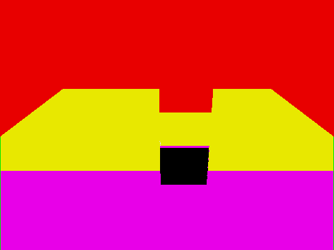
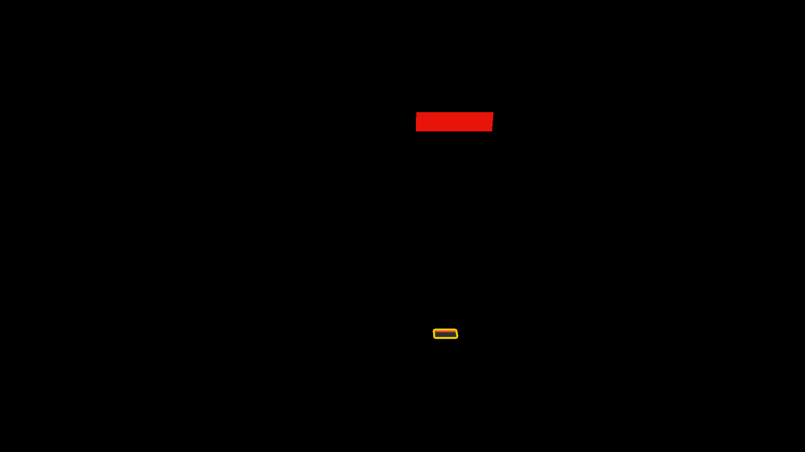
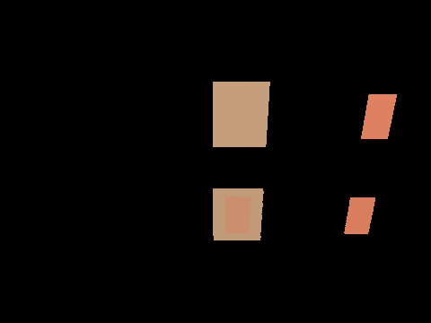
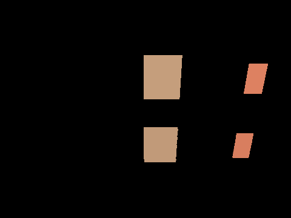
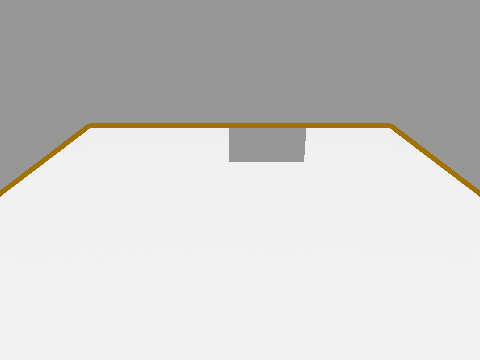
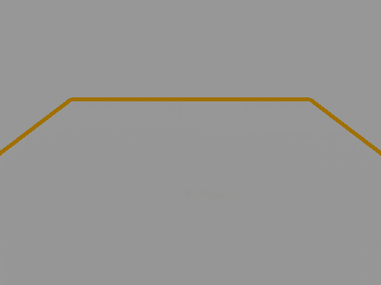
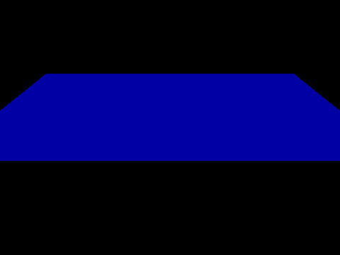

# Screen-space reflections

In the deferred renderer's Lit view, select `--screen-reflections low` or
`--screen-reflections high` at launch. For headless captures, also pass
`--display-mode lit`. Low and high allow up to 24 and 72 cell advances per
pixel, respectively. Rougher surfaces use fewer advances. Receiver departure
and mip descent share a separate allowance of two probes per selected mip
level. `confidence` displays the hit blend weight. `distance` displays the
dominant hit distance normalized to the 40 m trace limit. `source` shows the
screen contribution in green and the optional ray contribution in blue.
`history` displays the pixels that reused a previous reflection sample.
The default is `off`.

The pass snapshots the opaque scene-linear HDR buffer after lighting. It
projects each reflection ray into the current reverse-Z depth grid, clips it
to the view frustum, and traverses cells of a depth-bounds pyramid. Each cell
stores the nearest and farthest surfaces over its footprint in reverse-Z. The
marcher skips a cell when the ray stays entirely in front of the nearest
surface or behind the farthest surface. The hierarchy starts at half
resolution and reads scene depth directly at full resolution. Projected ray length and roughness
set the mip limit within each quality mode. Reciprocal clip W
interpolation supplies the view-space depth for the final check. A bounded
thickness test and the hit surface normal reject silhouette mismatches and
back faces. The full-resolution trace remains available if the optional
pyramid is unavailable.

See [Efficient GPU Screen-Space Ray Tracing](https://jcgt.org/published/0003/04/04/)
and [FidelityFX Stochastic Screen-Space Reflections](https://gpuopen.com/manuals/fidelityfx_sdk/techniques/stochastic-screen-space-reflections/).

The split-sum BRDF allocates specular energy once per receiver. The remaining
energy is available to diffuse IBL in proportion to the dielectric share of
the material. Baked diffuse irradiance and DDGI use the same Lambertian
normalization before blending. Ambient fill sets a floor on the diffuse term
inside that budget.

For a valid hit, the reflection pass replaces a share of the receiver's base
specular IBL. The screen hit spends its confidence first and the optional ray
hit can spend the remaining share. Both use the receiver's specular
reflectance, occlusion, and layer attenuation. Rough surfaces use a depth-
and normal-aware color filter, and confidence falls to zero by roughness 0.55.
Confidence also fades near the screen edge and trace limit. Misses keep the
original lit pixels.

The pass handles opaque and alpha-masked receivers. Transparency still
composites after the opaque reflection pass. Deferred OpenVDB media attenuate
the reflected opaque scene before fog and temporal resolve. Transmission
receivers and aerial perspective use the existing lighting route. Forward
rendering and ray-shadow visibility views bypass the reflection pass.

## Trace diagnostics

Use `--screen-reflections hit-uv --screenshot hit.exr` to read the
hit texel's center UV in R and G and the hit distance in scene metres in B.
Misses write zero across all three channels. `--screen-reflections miss-reason`
encodes the screen trace result in RGB. In a scene-linear EXR, red, green,
and blue carry bits 0, 1, and 2 of the reason code. Both views show the
current screen ray before temporal filtering or ray-query fallback.

| Code | Color | Result |
| --- | --- | --- |
| 0 | Black | Valid screen hit |
| 1 | Red | Ineligible receiver |
| 2 | Green | Invalid or degenerate projected ray |
| 3 | Yellow | Ray reached the screen or frustum edge |
| 4 | Blue | Ray reached the distance limit without an intersection |
| 5 | Magenta | Full-resolution depth or thickness test rejected the candidate |
| 6 | Cyan | Hit normal faced away from the incoming ray |
| 7 | White | Traversal exhausted its step budget |



## Hi-Z validation

The numeric fixture reads scene-linear EXR and checks the reflected card against
the projected pixel and physical hit distance. At 480×360 it measured 1.980 m
against 1.985 m analytically. It also checks a thin card at 483×363, roughness
attenuation, a clipped screen exit, and the depth-pyramid fallback when the
reduction shader is unavailable.

The 1920×1080 Low fixture projects a 506-pixel ray to the red card. The new
marcher reaches it both through empty space and past a foreground strip whose
screen projection crosses the ray. Both cases measured a mean red channel of
182 over the 7×7 receiver patch, up from 47 with reflections off.

| Full-resolution trace | Depth-bounds traversal |
| --- | --- |
|  |  |

On an RTX 2080 SUPER with driver 610.88, median High pass time at 480×360 fell
from 0.156 ms to 0.133 ms over 24 measured frames with Vulkan synchronization
validation. The pyramid adds 1,976,832 bytes and raises total pass allocation
with history from 10,321,920 to 12,298,752 bytes.

Run the fixture with Python, NumPy, Pillow, OpenCV with OpenEXR support, and an
available Khronos validation layer.

```powershell
python -B tests/validation/screen_reflections_runtime_regression.py `
  --renderer <renderer.exe> --output build/ssr-validation --managed-output `
  --marcher --validation-manifest <VkLayer_khronos_validation.json>
```

## Reflection history

Low and high quality vary the reflected direction over a small roughness-scaled
cone on each submitted frame with history enabled. The deferred graph copies
opaque object IDs after the scene and BIM G-buffers, before transparent
picking can overwrite them. Multisampled G-buffers resolve the integer ID
from sample zero. The spatial filter samples the screen hit
neighborhood and rejects object, depth, normal, and material boundaries.
The temporal filter projects the receiver into the previous jittered camera.
It checks reconstructed position, normal, hit distance, confidence, and
radiance agreement, plus a 32-bit fingerprint of the receiver and contributing
hit objects and materials. The fingerprint includes the screen/ray mix.
It averages the signed specular correction per unit of replacement, then
weights the result by the current confidence. A current miss immediately
restores the existing IBL. Exposure, fog, transparency, and TAA or FSR are
applied later.

Camera cuts, material or light edits, resolution or technique changes, shader
replacement, BIM visibility and semantic color changes, and ray topology
changes invalidate reuse. The previous camera and reflection history advance
on a successful graphics submission. A moving receiver that fails the surface
tests uses its current reflection sample. History uses the last submitted
frame with TAA enabled or disabled.

Two packed RGBA32UI history images use 32 bytes per render pixel before
allocation alignment. Each frame resource also owns a four-byte-per-pixel
opaque ID snapshot. `--no-screen-reflections-history` uses a deterministic
trace with the spatial filter. The renderer uses that trace when the history
allocation is unavailable or exceeds the 128 MiB history cap. When the ID
snapshot is unavailable, the spatial filter uses material, depth, and normal
tests. The confidence, distance, and source diagnostics remain deterministic.

### Temporal validation

The moving-card fixture measures the first frame after a disocclusion against
the same frame with a fresh history. When the foreground card revealed a
second card using the same material, the previous filter kept up to 44.1% of
the old color across the 9×9 patch. All 81 pixels now match the fresh frame
exactly. The `history` view shows complete rejection in the patch on that frame
and reuse of the new card on the next frame. A card that moves out of the
reflection and reveals the environment also matches its fresh frame.
At 4× MSAA, the replacement card likewise matched the fresh frame across all
81 pixels.

| Stale color in the reflected card | First frame after rejecting the previous card |
| --- | --- |
|  |  |

On the stationary rough mirror, temporal accumulation reduced per-pixel
frame-to-frame RMS variation from 0.02168 to 0.00697 in scene-linear RGB.
Mean radiance moved from 0.17160 to 0.17107. The tests compare matching rough
ray samples by resetting only temporal reuse for the spatial control.

At 480×360 on an RTX 2080 SUPER with driver 610.88, the median High pass time
over 24 frames was 0.160 ms before and 0.135 ms after the filter change.
The new ID copy took 0.007 ms median, and the two passes together took
0.142 ms median. Total reflection allocation went from 12,298,752 to
14,510,592 bytes. The ID snapshots account for the 2,211,840-byte increase.
Disabling history kept the spatial filter and reduced the history allocation
from 5,898,240 to 1,024 bytes for the placeholder images.

The 129-capture suite passed Khronos 1.4.363.1 synchronization validation.
It also covered manual reset, camera cuts, technique switches, material and
light edits, section clipping, scene reload, and a resize to 483×363. A BIM
storey filter separately reset reflection reuse at the first changed frame
while the TAA epoch stayed constant.

Run the disocclusion, roughness, fallback, and lifecycle fixtures with the
same dependencies as the Hi-Z fixture.

```powershell
python -B tests/validation/screen_reflections_runtime_regression.py `
  --renderer <renderer.exe> --output build/ssr-denoise --managed-output `
  --denoise --validation-manifest <VkLayer_khronos_validation.json>
```

## IBL energy validation

The furnace fixture renders white dielectric and metal receivers at four
roughnesses under constant half- and unit-radiance environments. It compares
matching, black, and brighter reflected cards in scene-linear EXR. Matching
radiance leaves the IBL response within the readback tolerance, while the
black card removes only the weighted specular response. The 0.28-roughness
unit-radiance receivers measured 0.981 for the dielectric and 0.995 for the
metal with SSR enabled.

The comparison below uses the same unit environment and exposure. Before the
diffuse normalization, the white dielectric field returned 3.02 units of
radiance. It now returns 0.984.

| Previous dielectric furnace | Corrected dielectric furnace |
| --- | --- |
|  |  |

The screen-edge fixture checks the analytic confidence ramp through an
off-screen exit. In the moving-camera case, a receiver's confidence fell from
0.267 to 0.064. The frame with accepted history and the fresh frame both
returned 0.49194 under half-radiance IBL. Use `--energy` in place of
`--marcher` to rerun these fixtures.

With the OpenVDB-enabled build and a purely absorbing medium, the difference
between reflected and unreflected pixels matched the clear-scene difference
multiplied by measured transmittance to within 0.00035 scene-linear units.
The previous composition order differed by up to 0.038 in the same fixture.

Under Vulkan synchronization validation at 480×360 on an RTX 2080 SUPER, the
High pass measured 0.133 ms median over 24 frames and used 12,298,752 bytes.
The previous build measured 0.132 ms with the same allocation.

## Off-screen fallback

Combine `--screen-reflections high` or `low` with
`--screen-reflections-ray-query` to fill screen misses and low-confidence
samples with the closest ray hit. The fallback reuses the shared acceleration
structure and surface attributes. The screen contribution keeps priority and
the ray spends only the remaining blend weight. A ray miss keeps the original
IBL in that weight. A compatible device can build the shared scene even with
raster shadows selected. Without an available ray shader or ray scene, the
screen-only pipeline remains active. Screenshot telemetry records whether the
ray mode was requested, available, and active. Scene preparation checks the
device's instance and primitive limits before recording acceleration-structure
commands.

The fallback evaluates glTF base color, vertex color, normal and material
textures, unlit and emissive radiance, and a single specular lobe. It uses
the raster tangent orientation on double-sided back faces and converts
specular-glossiness inputs to perceptual roughness. The receiver's shading
normal steers the ray. Its depth-derived geometric normal offsets the origin
and checks that the ray leaves the surface.
It uses one reflected ray per eligible pixel. Lit hits sample the existing IBL
and shadow one directional light, up to four or eight punctual lights, and up
to two or four area lights in low or high mode. Area lights use their centers
for this visibility estimate. Directional shadow tests use the 40 m range.
Alpha masks use the material cutoff, including equality, with coverage sampled
from base-mip textures at the transformed UV set. Section and box clipping
apply to hit and shadow queries. The reflection-only scene contains opaque
and masked draws. Blended and transmissive draws stay in the transparent pass,
and the ray skips them if another transport consumer needs them in the shared
scene. Additional surface lobes, recursive reflections, and volumetric transport
use their existing rendering routes.

The pass owns an RGBA16F opaque snapshot per swapchain image when enabled.
Screenshot telemetry reports actual reflection allocation bytes, depth
pyramid bytes and mip count, and whether the submitted reflection pass used the
pyramid. The `ScreenReflections` GPU interval includes pyramid generation and
reflection shading. Ray surface allocation and build costs appear in shared
ray-scene telemetry. Runtime shader reload and the Windows package include
both reflection kernels and the depth-bounds reduction kernel.

The 480×360 off-screen mirror fixture on an RTX 2080 SUPER measured 0.181 ms
for the screen pass and 0.235 ms with ray fallback. The opaque snapshots used
4,423,680 bytes in both cases, and the fixture's shared ray scene used 18,368
bytes. The fallback revealed the off-screen card and respected its opaque
occluder, alpha cutout, and directional shadow. The full 19-capture Vulkan
validation run also verified pixel-identical fallback with ray queries
disabled. The captures and timings are recorded in
`out/feature-parity/screen-reflections-ray-native/results.json`.

### Ray policy validation

The source view uses blue for ray-query confidence. A tilted shading normal
previously made a two-sided mirror hit itself about 2 mm from the origin.
The same receiver now reports zero ray confidence across the 5×5 test patch.

| Receiver self-hit | Ray rejected below the surface |
| --- | --- |
|  |  |

The blended-pane fixture now builds the same two instances as the clear
fixture. Its acceleration-structure allocation dropped from 9,984 bytes to
7,168 bytes. In the clear 480×360 off-screen fixture on an RTX 2080 SUPER,
the median High hybrid pass over 24 frames went from 0.168 ms to 0.178 ms
under synchronization validation. Reflection resources used 12,298,752
bytes, and the shared ray build used 7,168 bytes of acceleration storage,
1,280 bytes of input storage, and 5,632 bytes of scratch.

Use `--ray-policy` in place of `--marcher` on a ray-query-capable device to
check transformed alpha masks, transparent pass-through, section clipping,
self-hit rejection, and lit off-screen materials. The optional
`--missing-ray-renderer` takes a copy of the same runtime with its ray
reflection shader removed and compares the raster output.

In the lit fixtures, the glossy specular-glossiness card returned about
2.25 times the reflected radiance of the rough card. The tangent-space
normal-map fixtures gave identical off-screen radiance for the front and
double-sided back views under the same light.

The history run passed 57 captures across 28 Vulkan processes. The thin red
target fell from a mean red value of 190 to 47 on the first frame after
disocclusion, and stayed at 47 with and without TAA. The history view also
confirmed reuse on an off-screen ray hit. The lifecycle captures verified
camera cuts, material and light edits, resize, and raster technique switches.
With history enabled at 480×360, the off-screen pass measured 0.18 ms with
screen tracing and 0.24 ms with ray fallback. Total reflection allocation
was 10,321,920 bytes. Evidence is in
`out/feature-parity/screen-reflections-temporal-native/results.json`.
