# DDGI runtime validation on Windows / NVIDIA

These untouched captures and records were generated on October 9, 2026, using
an RTX 2080 SUPER, Vulkan 1.4.325 and the Visual Studio Release build.
The working tree was uncommitted; `snapshot-hashes.json` records the base commit,
renderer sources, executable, staged SPIR-V, fixture and capture hashes.

All 130 CPU tests in seven suites, seven production-kernel GPU tests and eleven
native renderer cases passed. Twelve affected SPIR-V modules passed Vulkan 1.4
validation. Native runs enabled synchronization validation and reported no
VUID, synchronization or runtime errors; existing unused-vertex-attribute
warnings remain in the logs.

Reproduce the native cases from a current source build:

```powershell
python tests/visual-regression/ddgi/run_runtime.py --output out/ddgi-validation
```

Build/test commands and the lighting policy are in
[DDGI runtime notes](../../../../docs/ddgi-probe-foundation.md).
`runtime-results.json` records exact commands and all 90 motion-sequence frames.
Camera motion keeps epoch 1, the light edit starts epoch 2, and one object edit
starts epoch 3. Continuous motion advances the cursor every frame, keeps TAA
history, and finishes a fresh sweep after motion stops. Surface-budget rejection
disables GI while preserving hard ray shadows. Paused and one-probe budgets
retain their expected counters.

| Renderer | Direct light (`--ddgi-intensity 0`) | Probe GI (`--ddgi-intensity 1`) |
| --- | --- | --- |
| Deferred | 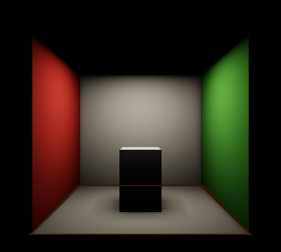 | 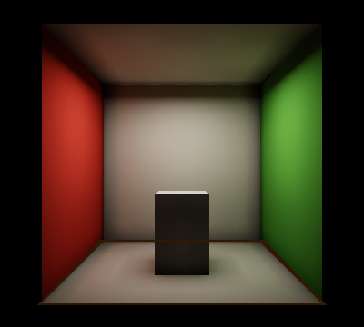 |
| Forward | 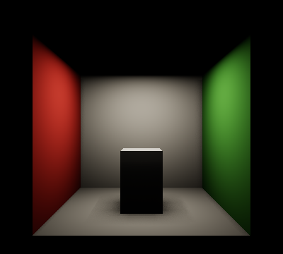 | 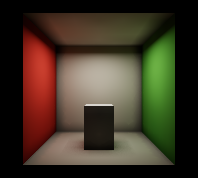 |

The 343-probe volume updates 128 probes / 16,384 rays per frame, completing a
sweep in three submitted frames. Probe allocations total 3,038,992 bytes;
the shared ray scene totals 70,496 bytes. Snapshot GPU times were approximately
0.064 ms for tracing and 0.144 ms for updating. These single-frame observations
are not a benchmark; fragment lookup is included in Lighting.

The ceiling lies exactly on the volume's upper bound. Both paths now light it;
the deferred reconstruction margin prevents boundary rejection. Display-space
forward/deferred GI mean absolute error is 0.00133 on a 0–1 RGB scale.
`validation-summary.json` records fixed rectangles showing red/green bounce
on the floor and back wall. PNG measurements include tone mapping and
quantization, so they are not HDR reference error bounds.

At this initial snapshot, debug views, interactive volume/quality controls,
larger architectural and thin-wall quality sweeps, additional GPUs and sustained
performance/reference comparisons remained in epic #42. The follow-ups below
record later changes separately. These results validate the experimental runtime
slice, not the entire epic.

## Optional surface validation follow-up

The later fix handles invalid optional surface attributes and normal-transform
overflow without terminating the renderer. GI reports its fallback reason;
hard/soft ray shadows keep the compact scene. Repeated rejected revisions do
not rebuild it, and repaired geometry or transforms restore surface extraction.
Invalid required geometry still reports an extraction error.

The Visual Studio Release build passed 19 CPU cases and 13 ray-shadow GPU cases
with no skips. Two native renderer cases exercised an invertible tiny-scale
transform whose normal transform overflows: raster disables the shared scene,
while hard ray shadows retain all 11 Cornell instances. Both reported zero
Vulkan validation or runtime errors. The GPU suite additionally covers soft
shadows, repeated frame slots, attribute failures and recovery after repairs.

```powershell
$env:CONTAINER_RUN_GPU_RAY_QUERY='1'
ctest --test-dir out/build/visual-studio -C Release -R '^(ray_scene_tests|ray_shadow_surface_gpu_tests)$' --output-on-failure
python tests/visual-regression/ddgi/run_runtime.py --surface-validation-only --output out/ddgi-surface-validation
```

`surface-fallback-results.json`, `surface-fallback-test-results.txt` and
`surface-fallback-snapshot.json` record this follow-up separately. The original
captures and `snapshot-hashes.json` above describe the earlier source build.

## Interactive controls and probe diagnostics follow-up

The scene controls now support live enable/disable, pause/resume, frame budgets,
intensity, tracing/blending controls and validated volume/ray-quality drafts.
Resource growth or a lattice change retires submitted GPU work before rebuilding;
pause, reduced budgets and intensity edits preserve submitted history.
The four diagnostic views work in both raster techniques and obey opaque scene
depth. Diagnostic changes preserve the transport epoch and TAA history.

The Visual Studio Release build passed 111 CPU cases in five suites and 27 GPU
cases in three suites, with no failures or skips. Two new graphics readback cases
verify near-plane-crossing spheres, opaque-depth rejection and off-axis
orthographic silhouettes. All 12 native diagnostic cases passed with zero
validation/runtime errors, including paused and unsupported-device routes.
Matched frame/settings comparisons confirm each of the eight overlays changes
the output of its forward/deferred baseline. Two diagnostic SPIR-V modules
passed Vulkan 1.4 validation.

```powershell
python tests/visual-regression/ddgi/run_runtime.py --debug-only --output out/ddgi-debug-validation
```

`interactive-debug-results.json` records commands, metadata and image checks;
`interactive-debug-cpu-tests.txt`, `interactive-debug-gpu-tests.txt` and
`interactive-debug-snapshot.json` record test results and this source snapshot.
The images below are untouched six-frame native captures. Irradiance uses the
fixed diagnostic `E/pi -> x/(1+x)` display; visibility shows normalized mean
distance and relocation shows normalized movement. Overlapping probe markers
use instance draw order, so a small radius is useful for dense grids.

| Irradiance | Visibility |
| --- | --- |
| 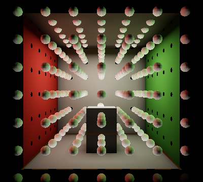 | 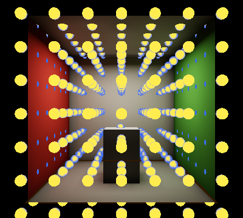 |

| Classification | Relocation |
| --- | --- |
| 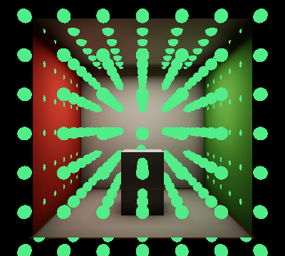 | 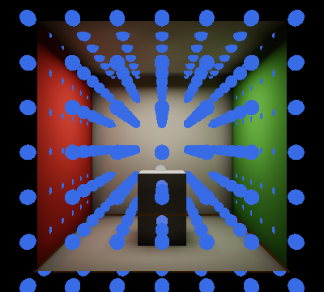 |

## Architectural quality, references and repeated timing follow-up

The next source snapshot adds deterministic metre-scale architectural fixtures,
an independent CPU diffuse reference, motion assertions and repeated timing
tools. It also fixes relocation movement detection at tiny lattice scales and
adds native capture enable/pause events and profiler latency metadata. Windows
package checks require every DDGI/debug/fallback shader and include the guide.

This follow-up passed 14 capture CPU cases, 40 Python geometry/reference/metric
cases and eight production update-kernel GPU cases, with no skips. All 15 native
quality cases passed with zero validation/runtime errors. Two full independent
CPU reference images were rendered at 192x128, 128 paths/pixel and eight
scattering vertices. Point references use 16,384 paths per receiver.

| Native doorway, probes | Independent CPU Lambertian reference |
| --- | --- |
| 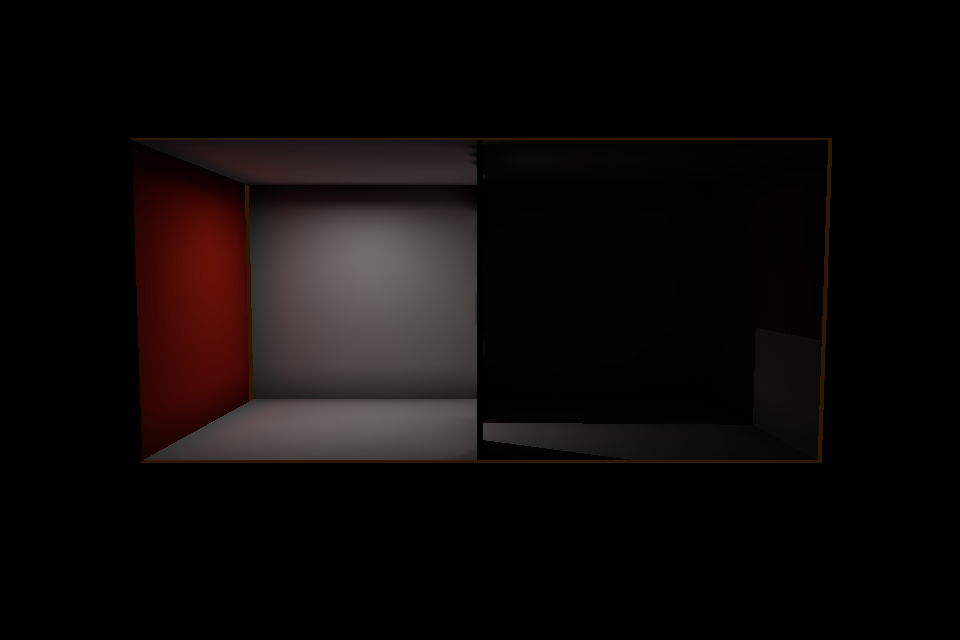 | 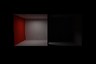 |

| Native sealed 3 cm divider, normal grid | Coarse 0.75 m grid |
| --- | --- |
|  | 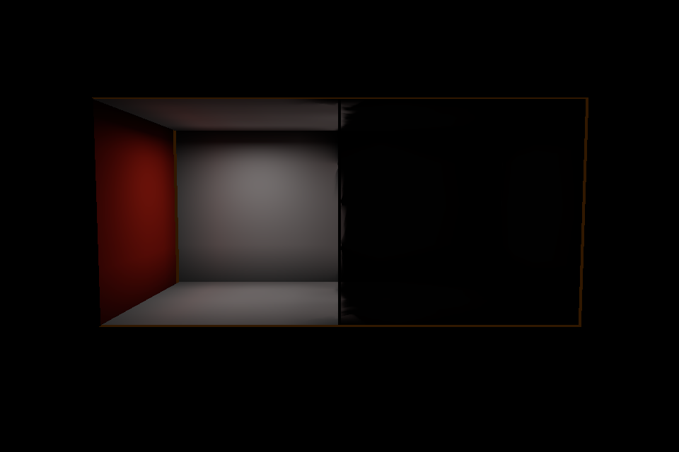 |

The sampled doorway back-wall receiver has zero direct light and estimated
indirect luminance 0.0596 (CPU reference 0.0758). Lit-room indirect red/green is
1.436, versus 1.0 for the neutral-wall control. Normal/fine grids keep the sealed
shaded receivers black; the forward capture agrees with deferred. Coarse-grid
leakage is 8.24% of the open-room response. Its matched zero-primary-intensity
control is black, confirming actual transport leakage rather than fallback
brightness. Fine/coarse warmups match average visits per probe, so resolution
is not confounded with their different scheduling budgets.

The motion sequence asserts camera-only epoch stability, light refresh without
AS rebuild, moving-partition epochs/generations, preserved scheduling and fresh
sweep completion after motion stops. A fresh 637-probe/256-update sweep takes
three submitted frames; multi-bounce/hysteresis convergence takes longer.

The performance run collected 2,700 measured GPU samples from 30 launches:
1024x768, both techniques, three repeats per off/paused/low/default/high mode,
120 warmup frames, six settling frames and 90 samples. Default trace+update
pooled medians are approximately 0.269 ms deferred and 0.270 ms forward, with
2.90 MiB of probe resources. The median of matched paused-minus-off Lighting
medians is +0.514 ms/+0.525 ms. These capture timings describe the complete
lighting-route change; PNG readbacks serialize frames and prevent an FPS claim.
Profiler results lag submission counters by one completed frame.

The original checker mistook the paused empty-batch index for the internal
scheduling cursor. `performance-results.json` preserves that diagnostic under
`checkerCorrection` and validates the unchanged captured data against retained
history/epoch/allocation counters and zero batch indices. No native failure or
runtime error was suppressed.

`architectural-quality-results.json`, `performance-results.json`,
`cpu-reference-image-results.json`, saved PNG/NPZ references, test logs and
`quality-performance-snapshot.json` record this follow-up separately from all
earlier immutable snapshots. `performance-raw-results.json.gz` retains every
captured frame and timestamp; the readable performance JSON contains the
summaries and warmup checkpoints. References are finite-depth Lambertian estimates;
the renderer uses PBR/Fresnel attenuation and a coarse probe approximation.
Native estimates also carry PNG quantization and inverse-tone-map error.
This is single-device, opaque single-sided fixture coverage; complex BIM
materials and other devices need their own measurements.

## Lookup arithmetic and material lifecycle follow-up

The latest source snapshot removes fixed world-unit tolerances from spatial
lookup directions, distances and visibility ratios. Six GPU cases include the
production lookup shader and check metre and 1e-8 scales, constant physical
irradiance, facing rejection, moment visibility, valid occluded black and
missing-data fallback. This isolates lookup arithmetic; the trace ray-origin
floor still limits microscopic end-to-end transport.

All 15 architectural quality cases passed again on the updated binary. Doorway
indirect luminance remains 0.0596, and the measured coarse-grid leakage remains
8.24% of the open-room response. The earlier evidence above remains unchanged.

Twelve additional native launches passed material and live-control checks with
no validation/runtime errors. Matched single/double-sided solid, sheet and
doorway fixtures preserve geometry and lighting. The solid and double-sided
sheet receivers stay black. A back-facing single-sided sheet gives 43.27% of
the open-room response, but its zero-primary-indirect control gives 41.13%; the
isolated DDGI contribution is 2.15%. The total response therefore cannot be
reported as GI leakage. Opaque sheets requiring shadows from both sides should
use the double-sided material policy or closed geometry with thickness.
Double-sided solid hits provide no enclosing-backface classification evidence,
so these observations do not establish a general topology or BIM guarantee.

| Single-sided sheet, source behind the face | Double-sided sheet |
| --- | --- |
| 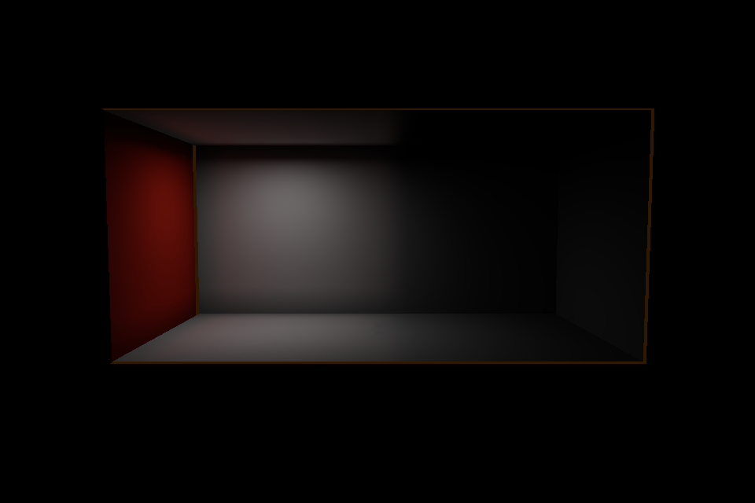 | 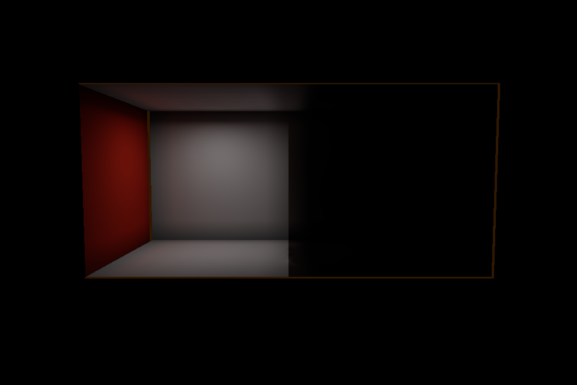 |

Both render techniques captured all 24 live lifecycle frames, including enable,
pause, resume, disable and re-enable. Probe allocations stayed at 5,353,008 bytes
after activation; 16 submitted updates left the retained scheduling cursor at
274. The new `schedulingCursor` telemetry makes that retention observable while
paused batch indices remain zero. The forced ray-query capability fallback
also passed.

The Visual Studio Release build passed 112 focused C++ checks, 56 Python checks
and 21 GPU cases without skips. Twenty runtime shader modules and the isolated
lookup contract passed Vulkan 1.4 SPIR-V validation. The refreshed timing matrix
passed all 30 launches and collected 2,700 samples with the same warmup,
resolution and rotated repeat order as before. Default trace/update pooled
medians total approximately 0.270 ms in either technique, with 2.90 MiB of
probe resources. The median of three matched paused-minus-off Lighting medians
is +0.589 ms deferred and +0.551 ms forward. The complete frame/timestamp archive
and repeat distributions are saved; these capture results do not establish
interactive FPS or a controlled comparison against the earlier build.

```powershell
$env:CONTAINER_RUN_GPU_DDGI='1'
ctest --test-dir out/build/visual-studio -C Release -R '^(ddgi_gpu_tests|ddgi_manager_gpu_tests|ddgi_lookup_gpu_tests|ddgi_lookup_spirv_validation)$' --output-on-failure
python tests/visual-regression/ddgi/run_material_quality.py --output out/ddgi-material-validation
```

The separate `lookup-material-*` records bind this follow-up to the executable,
all runtime shader assets, source files, test logs and native captures. Earlier
snapshot files continue to describe their original builds.

## One-shot scene fitting follow-up

The October 10, 2026 source snapshot adds `--ddgi-fit-scene`, a fitted-probe
budget, and an explicit live scene-fit request. Fitting uses referenced triangle
positions with current world transforms. It supplies a padded uniform lattice,
cell-scaled biases and diagnostic radius, and a trace distance covering the
padded diagonal. Fitting preserves the requested GI enabled state; use `--ddgi`
to activate the fitted field. Scene motion alone does not refit the volume.

The Visual Studio Release build passed 98 focused CPU cases, seven manager GPU
cases and 69 Python cases. Twelve native captures and eleven parser rejection
cases passed on the NVIDIA GeForce RTX 2080 SUPER. Native logs contain no
validation/runtime errors. The matrix covers Cornell import scales 0.001, 1 and 1000 in
both raster techniques, plus the existing equivalent glTF, BIM and USD scenes.
It checks source bounds, outward coverage, isotropic spacing, probe/payload
caps, scaled tracing parameters, disabled GI and forced ray-query fallback.
Parser checks reject conflicting manual fit parameters, including a
reversed-order origin option, and invalid fitted-probe budgets before Vulkan
initialization.

The default 2,048-probe cap fitted the metre-scale Cornell scene with 1,728
probes: 9,643,008 bytes of planned payload and 10,943,168 bytes of actual probe
allocations on this device. The 1 MiB startup regression uses the minimum
padded 4x4x4 Cornell lattice, with 64 probes, 462,848 planned bytes and 466,624
actual bytes. Startup checks use fitting-compatible placeholders, allowing
this valid final volume to load under the tight cap.

The live architectural sequence moves `Partition` and requests a refit in the
same frame, frame 4. The source maximum X changes from 3 to approximately 5.03,
and the lattice changes from 10x7x7 to 12x6x7. New history starts at update frame
1 in that capture and advances to update frame 5 by capture frame 8, without
another reset. This exercises current object-transform publication before the
fit request, rather than allowing an intervening frame to refresh stale bounds.

```powershell
python tests/visual-regression/ddgi/run_volume_fit.py --output out/ddgi-volume-fit-validation
python -m unittest discover -s tests/visual-regression/ddgi -p test_volume_fit.py
```

`scene-fit-native-results.json`, `scene-fit-native-tests.txt`,
`scene-fit-python-tests.txt`, `scene-fit-build.txt` and `scene-fit-snapshot.json`
record this follow-up separately. These checks establish scene setup and
resource/history behavior; they do not add lighting-quality, convergence or
performance measurements. Earlier capture and benchmark records remain tied
to their original snapshots.
